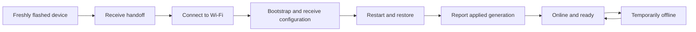

A device has several independent states. It can be provisioned, temporarily offline, and waiting for a configuration generation at the same time. Keep these signals separate when diagnosing a device.

| Area | Question | Examples |
| --- | --- | --- |
| Provisioning | Does the device have a Flova identity? | waiting, provisioned |
| Presence | Has it connected recently? | online, offline |
| Configuration | Has the desired generation been applied? | pending, applied, verifying |
| Administration | Is it allowed to operate? | active, disabled, archived |

## Normal route

Being offline does not by itself mean provisioning failed. Firmware should follow its local reconnect policy and synchronize status and data after the connection returns. A heartbeat can prove presence, but it cannot prove that configuration was applied or that a command was acknowledged.

## The same boundaries in the SDK

Custom firmware can expose these boundaries through the SDK lifecycle APIs:

| Concept | SDK signal |
| --- | --- |
| Provisioning stage | `provisioning()` and `lifecycle()` |
| Local network | `networkConnected` |
| FlovaLink connection | `linkConnected` or `connected()` |
| Runtime readiness | `runtimeReady` |
| Datastream readiness | `ready` |
| Applied configuration | `configurationGeneration` |

Use `setStatusListener()` for changes and `status()` for the current value. A connected Wi-Fi network does not guarantee that the device is online in Console, and an online heartbeat does not replace an applied configuration report.

## When troubleshooting

First identify the failing boundary: QR and handoff, Wi-Fi, FlovaLink, configuration download, restart, or hardware behavior. Then use the device details page and the [troubleshooting guide](/en/docs/support/troubleshooting) to check the last observed state and timestamp.

