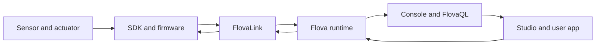

FlovaLink is the path that firmware uses to communicate with Flova. The device reports sensor data, Flova stores it for dashboards and FlovaQL, and user or automation commands travel back to the device through the same product model.

## Difference from common MQTT

MQTT is a general publish/subscribe pattern. With plain MQTT, your application usually has to define topics, payloads, ACLs, retries, schemas, acknowledgements, and their relationship to the product model. FlovaLink coordinates these boundaries for Flova devices.

| Area | FlovaLink | Plain MQTT |
| --- | --- | --- |
| Data model | Datastreams defined in a Device Type | Application-owned topics and payloads |
| Commands | Connected to datastreams and device status | Application-owned command and response topics |
| Retry and acknowledgement | Part of the product runtime | Designed by the client and broker integration |
| Provisioning | Works with activation and firmware lifecycle | Usually implemented outside the broker contract |
| Versioning | Device Type and configuration generations | Added to topics or payloads by the application |
| Product experience | Directly connected to Console, Studio, and FlovaQL | Requires separate product layers |

FlovaLink reduces duplicate contracts between firmware and the product. Actual bandwidth savings depend on data types, field counts, transmission frequency, and network conditions; a fixed multiplier should not be treated as a product guarantee without a repeatable benchmark.

## When the network is disconnected

Firmware should follow the local policy of each datastream. Queued data and the last valid state can be synchronized after reconnect. Expired or rejected commands must not be reported as successful. A heartbeat proves presence; it does not replace an accurate datastream report, configuration acknowledgement, or command acknowledgement.

## What the application does not need to implement

Normal users do not need to implement the internal frame format. The SDK datastream layer handles message queuing, retry, TLS, and connection boundaries. If you are building a custom gateway or board, follow the [custom board contract](/en/docs/sdk/custom-boards) instead of creating a second data engine inside the application.

